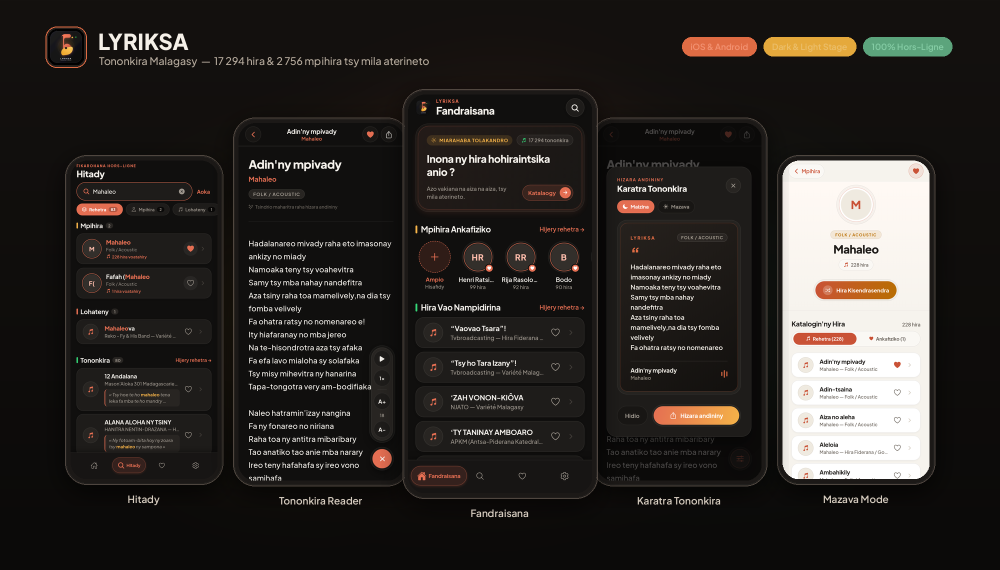
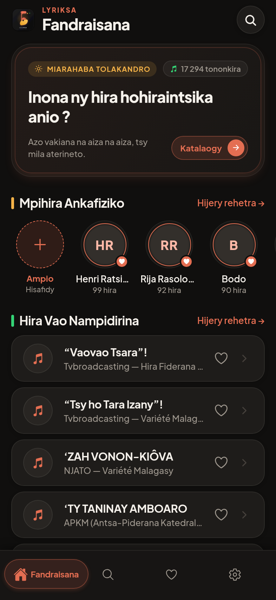
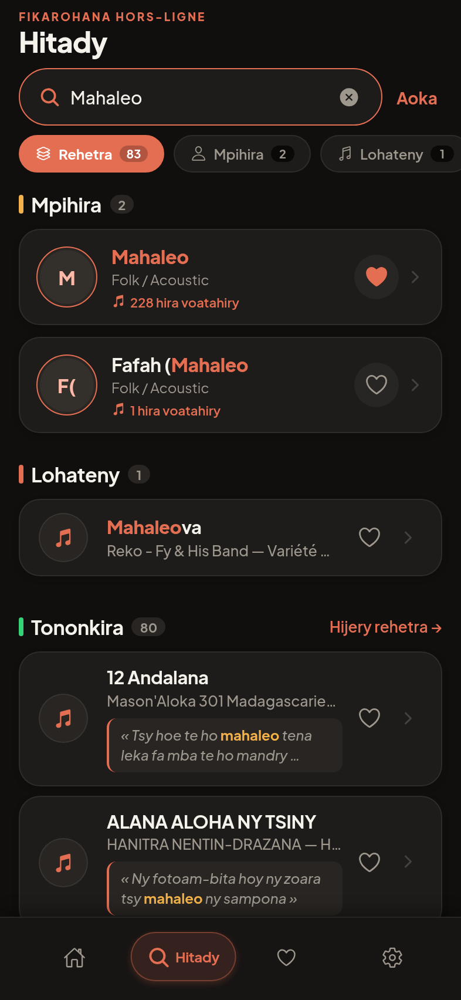
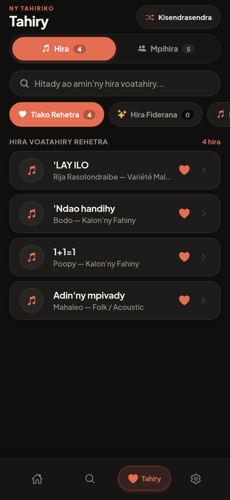
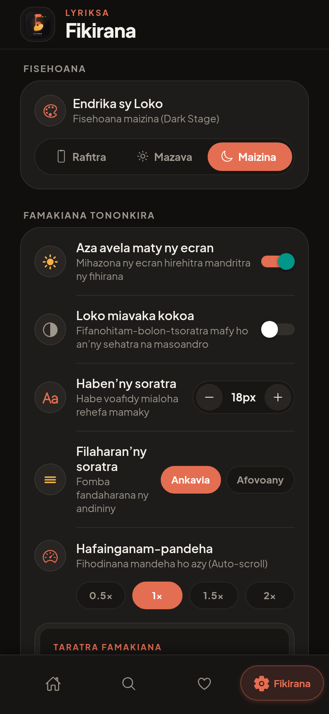
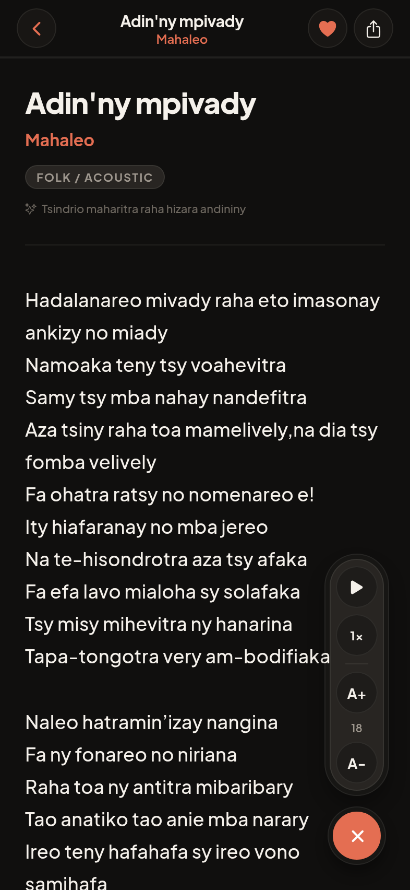
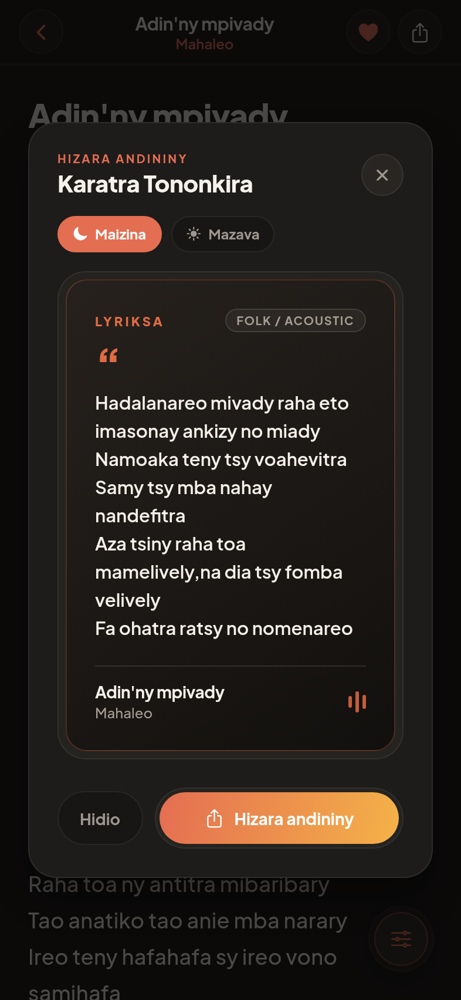
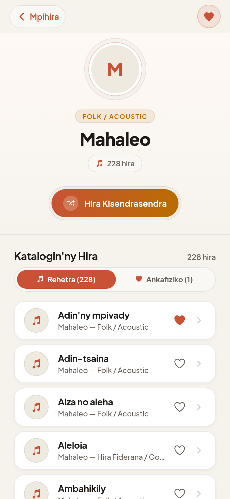

<div align="center">



# LYRIKSA — Tononkira Malagasy Hors-Ligne

**Plus de 17 294 paroles et 2 756 artistes malgaches dans votre poche, accessibles partout sans connexion internet.**

[](https://expo.dev)
[](https://reactnative.dev)
[](https://www.typescriptlang.org)
[](https://docs.expo.dev/versions/latest/sdk/sqlite/)
[](./.github/workflows/build-ios-unsigned.yml)

</div>

---

## Aperçu & Fonctionnalités

**Lyriksa** est une application mobile iOS, Android et Web pensée pour lire, chanter et retrouver instantanément le patrimoine musical malgache sans dépendre d’une connexion réseau.

- **Catalogue 100 % hors-ligne** : **17 294 chansons**, **2 756 artistes & groupes** et **374 collaborations** stockés localement via `expo-sqlite` (avec repli Web `localStorage`).
- **Accueil éditorial (*Fandraisana*)** : mise en avant quotidienne, accès direct aux **Mpihira Ankafiziko** (favoris + artistes issus des chansons aimées), nouveautés (*Hira Vao Nampidirina*) et historique récent (*Hira Nosokafana Farany*).
- **Recherche instantanée (*Hitady*)** : filtrage multi-facettes (*Rehetra*, *Mpihira*, *Lohateny*, *Tononkira*) avec surlignage des extraits et historique **Notadiavina farany** modifiable.
- **Carnet personnel (*Tahiry*)** : favoris unifiés Chansons & Artistes avec sélecteur segmenté animé, recherche interne, lecture aléatoire (*Kisendrasendra*) et barre d’annulation *Avereno*.
- **Lecteur immersif (*Tononkira*)** :
  - Barre de progression de lecture en temps réel et mode sans distraction (*Tap-to-Focus*).
  - Capsule flottante **AutoScrollHUD** : défilement automatique (`0.5x` à `2x`) et ajustement rapide de la taille du texte (`14px` à `32px`).
  - **Karatra Tononkira** : appui long sur n’importe quel couplet pour prévisualiser et partager une carte citation (mode *Maizina* ou *Mazava*).
- **Fiche artiste parallaxe** : avatar Double-Bezel, en-tête collant progressif, tri *Rehetra / Ankafiziko* et lecture aléatoire sur la discographie de l’artiste.
- **Personnalisation complète (*Fikirana*)** : thèmes **Rafitra / Mazava / Maizina** (*Warm Dark Stage* `#100F0E` et *Acoustic Parchment* `#F6F3ED`), maintien d’écran actif, contraste élevé, alignement et aperçu typographique en direct (*TARATRA FAMAKIANA*).

---

## Captures d’écran réelles

<div align="center">

| Fandraisana (Accueil) | Hitady (Recherche) | Tahiry (Favoris) | Fikirana (Paramètres) |
| :---: | :---: | :---: | :---: |
|  |  |  |  |

| Lecteur & Auto-Scroll | Karatra Tononkira | Fiche Artiste (Mode Clair) |
| :---: | :---: | :---: |
|  |  |  |

</div>

---

## Installer sur iPhone gratuitement (sans Mac, via GitHub Actions)

Ce dépôt inclut le workflow [.github/workflows/build-ios-unsigned.yml](./.github/workflows/build-ios-unsigned.yml) qui compile gratuitement un fichier **`Lyriksa-unsigned.ipa`** sur les serveurs macOS de GitHub.

1. Sur GitHub, ouvrez l’onglet **Actions** → **Build Unsigned iOS IPA** → **Run workflow** (ou créez un tag `v*`, ex. `v1.0.0`).
2. À la fin du job (~8–12 min), téléchargez l’artefact **`Lyriksa-unsigned-ipa`** et décompressez-le pour récupérer `Lyriksa-unsigned.ipa`.
3. Signez et installez l’`.ipa` sur votre iPhone avec votre **Apple ID gratuit** via **Sideloadly** (Windows/macOS) ou **AltStore / SideStore** (note Apple : avec un compte gratuit, la signature locale se rafraîchit tous les 7 jours).

*(Sur **Android**, `npx eas-cli@latest build --platform android --profile preview` permet également de générer un `.apk` autonome gratuitement.)*

---

## Développement local

```bash
# 1. Installer les dépendances
npm install

# 2. Démarrer le serveur Expo / Metro
npx expo start

# 3. Vérifier le typage TypeScript strict
npx tsc --noEmit
```

---

## Stack Technique

- **Framework** : Expo SDK 58 (`expo-router`, Continuous Native Generation, React Compiler)
- **UI & Motion** : `react-native-reanimated` 4, `expo-linear-gradient`, `expo-haptics`, `@expo-google-fonts/plus-jakarta-sans`
- **Stockage hors-ligne** : `expo-sqlite` (mobile natif) & `localStorage` validé (Web)

---

## Crédits & Auteur

- **Création, développement & design** : **ANDRINASOLONIRINA Hoby Senny**
- **Source des paroles** : [tononkira.serasera.org](https://tononkira.serasera.org)
